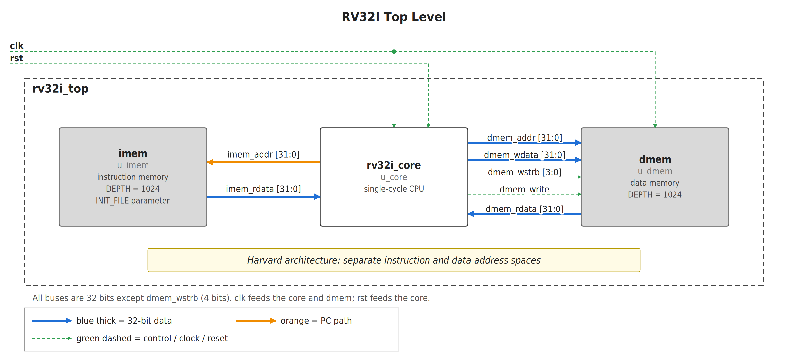
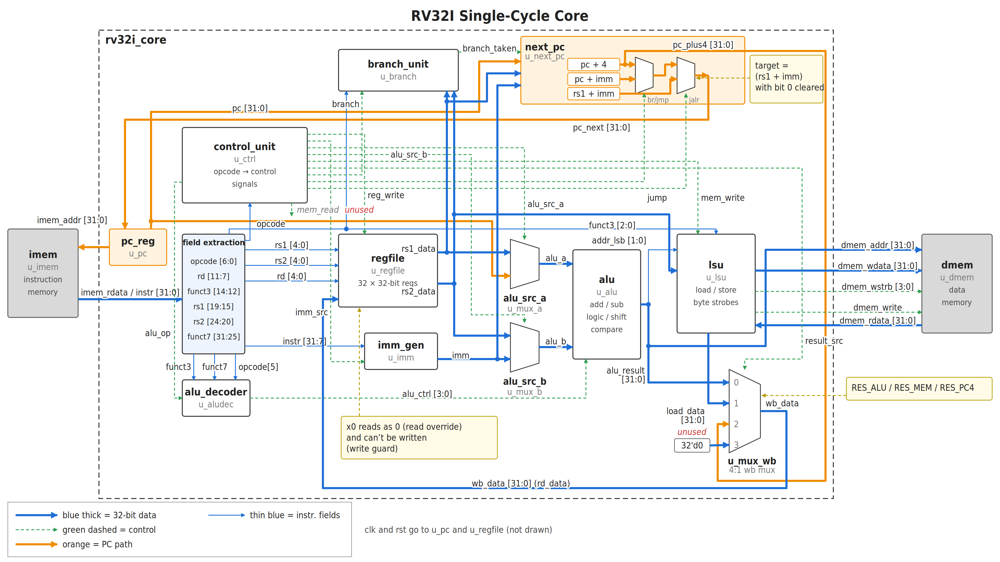
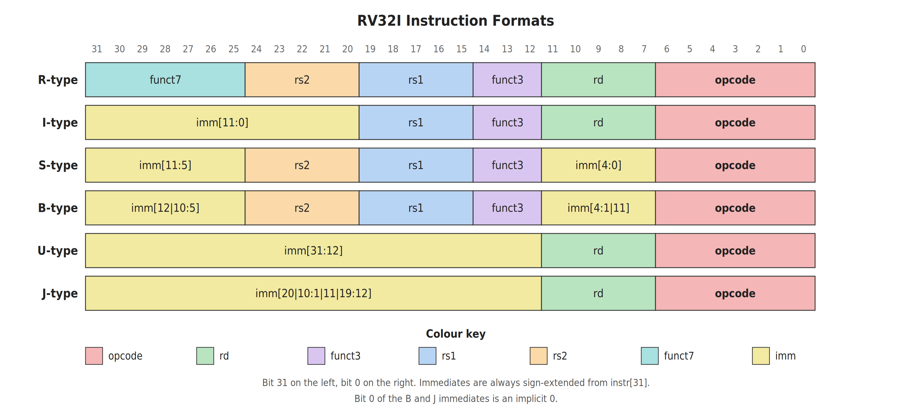
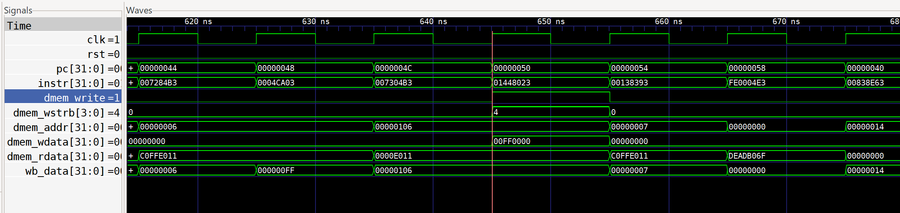

# RV32I Single-Cycle Processor

A single-cycle RISC-V processor written in Verilog, implementing the complete **RV32I base integer instruction set**. Designed from scratch as a learning project. Every module is hand-written, no IP cores or generated code.



## Features

- **Single-cycle execution** - one instruction completes every clock cycle
- **Harvard architecture** - separate instruction and data memories
- **Full RV32I support** - all 37 base integer instructions:
  - Arithmetic: `ADD`, `SUB`, `ADDI`
  - Logic: `AND`, `OR`, `XOR`, `ANDI`, `ORI`, `XORI`
  - Shifts: `SLL`, `SRL`, `SRA`, `SLLI`, `SRLI`, `SRAI`
  - Comparisons: `SLT`, `SLTU`, `SLTI`, `SLTIU`
  - Loads: `LB`, `LBU`, `LH`, `LHU`, `LW`
  - Stores: `SB`, `SH`, `SW`
  - Branches: `BEQ`, `BNE`, `BLT`, `BGE`, `BLTU`, `BGEU`
  - Jumps: `JAL`, `JALR`
  - Upper immediates: `LUI`, `AUIPC`
  - `FENCE`, `ECALL`, `EBREAK` treated as NOPs
- **Byte-granular memory** - the load-store unit handles sub-word alignment with write strobes
- **7 test programs** with automated pass/fail checking
- **9 unit testbenches** for individual modules

## Architecture

The core is split into clean, single-responsibility modules:



**Datapath flow:** PC → instruction memory → decode → register file → ALU → data memory → writeback

| Module | What it does |
|---|---|
| `pc_reg` | Program counter with synchronous reset |
| `control_unit` | Decodes opcode into control signals |
| `alu_decoder` | Picks ALU operation from funct3/funct7 |
| `imm_gen` | Generates sign-extended immediates (I/S/B/U/J) |
| `regfile` | 32x32-bit register file, x0 hardwired to zero |
| `alu` | 11 operations: add, sub, shifts, comparisons, logic, pass-through |
| `branch_unit` | Evaluates all six branch conditions |
| `next_pc` | Chooses between PC+4, branch target, JAL, or JALR |
| `lsu` | Byte-lane alignment for loads and stores |
| `mux2` / `mux4` | Parameterised multiplexers |
| `adder` | 32-bit adder (used for PC+4, PC+imm, rs1+imm) |

### Instruction Formats



## Directory Structure

```
rtl/           Synthesisable Verilog (the processor itself)
tb/            Testbenches - 1 integration + 9 unit
sw/            Test programs: assembly (.s), machine code (.hex), expected results (.expect)
docs/          Block diagrams and waveform screenshots
sim/           Simulation outputs (generated, gitignored)
Makefile       Build/run for Linux and macOS
run_all.bat    Build/run for Windows
run_one.bat    Run a single test on Windows
```

## Getting Started

### Prerequisites

You just need [Icarus Verilog](http://iverilog.icarus.com/). It's free and works on all platforms.

- **Linux:** `sudo apt install iverilog` (Debian/Ubuntu) or `sudo pacman -S iverilog` (Arch)
- **macOS:** `brew install icarus-verilog`
- **Windows:** download the installer from the [Icarus Verilog website](http://bleyer.org/icarus/)

### Run all tests

**Linux / macOS:**
```bash
make
```

**Windows:**
```
run_all.bat
```

You should see:
```
  PASS  arith_loop
  PASS  p1_arraysum
  PASS  p2_gcd
  PASS  p3_fib
  PASS  p4_memcpy
  PASS  p5_coverage
  PASS  p6_gapfill
```

### Run a single test (with waveform)

**Linux / macOS:**
```bash
make run P=p2_gcd
```

**Windows:**
```
run_one.bat p2_gcd
```

This saves a `.vcd` waveform file you can open in [GTKWave](http://gtkwave.sourceforge.net/) or any VCD viewer.

### Example waveform

Here's a snippet from the `p4_memcpy` test showing the PC advancing, instructions being fetched, and data memory writes happening:



## Test Programs

| # | Program | What it exercises | Cycles |
|---|---|---|---|
| 1 | `arith_loop` | R-type and I-type arithmetic (ADD, SUB, shifts, SLT, etc.) | 18 |
| 2 | `p1_arraysum` | Loops, array loads and stores | 163 |
| 3 | `p2_gcd` | GCD algorithm with heavy branching | 52 |
| 4 | `p3_fib` | Fibonacci sequence using memory + loops | 131 |
| 5 | `p4_memcpy` | Memory copy with byte-width loads and stores | 116 |
| 6 | `p5_coverage` | All branch types, LUI, AUIPC, JAL, JALR, all load/store widths | 45 |
| 7 | `p6_gapfill` | Register-operand shifts (SLL/SRL/SRA), SLTI, SLTIU, XORI | 14 |

Each program has:
- `.s` - commented RISC-V assembly source
- `.hex` - machine code (loaded by `$readmemh`)
- `.expect` - expected register and memory values, checked automatically by the testbench

## How Testing Works

The integration testbench (`tb/tb_rv32i.v`) does the following:
1. Loads a `.hex` program into instruction memory
2. Holds reset for 3 cycles, then releases
3. Waits until the PC stops changing (the program hits an infinite loop = "done")
4. Reads the `.expect` file and checks each register/memory value
5. Prints PASS or FAIL for every check, then a summary

There are also 9 unit testbenches that test individual modules in isolation (ALU, branch unit, control unit, register file, etc.).

## Future Ideas

Some ways this could be extended:
- **Pipeline it** - turn this into a 5-stage pipelined processor with hazard detection and forwarding
- **Add CSRs** - implement the RISC-V Control and Status Registers for interrupt handling
- **M extension** - add hardware multiply and divide (MUL, DIV, REM)
- **FPGA synthesis** - target a real board (iCE40, Artix-7, etc.)
- **Cache** - replace the simple memories with an instruction/data cache

## License

MIT - see [LICENSE](LICENSE) for details.

---

Built by [@Vanshikagupta100](https://github.com/Vanshikagupta100)
